# Automated Agent Red-Teaming & Adversarial Security Tester

A bounded, operator-run assessment harness for authorized OpenAI-compatible agent endpoints. It executes ordered multi-turn probes, checks final responses against operator-supplied success patterns, and produces an aggregate report without storing response text.

## Workflow

```mermaid
flowchart LR
  O[Authorized operator] --> C[Campaign request]
  C --> V[Validate schema, HTTPS and host allowlist]
  V --> P[Run bounded multi-turn probes]
  P --> T[Explicit target endpoint]
  T --> R[Target response, kept in memory]
  R --> E[Pattern check and refusal heuristic]
  E --> A[Outcome: vulnerable, resisted, inconclusive]
  A --> J[Report: timing, status, counts only]
  J --> F[Local JSON report]
```



## Quick start

```sh
python3 -m venv .venv
source .venv/bin/activate
python -m pip install -r requirements.txt
export REDTEAM_ALLOWED_HOSTS=localhost
uvicorn app.main:app --reload --port 8000
```

Use the sample probes as a template. Send a campaign to `POST /v1/campaigns` with a target URL, optional target bearer token, and probes. Target URLs must end in `/v1/chat/completions`; HTTPS is required except localhost, and the host must match `REDTEAM_ALLOWED_HOSTS`. Reports are written under `reports/` (override with `REDTEAM_REPORT_DIR`).

```sh
curl -sS http://127.0.0.1:8000/v1/campaigns \
  -H 'Content-Type: application/json' \
  --data @campaign.json
```

Do not point the tool at a third-party system without written authorization and an agreed scope. Do not place secrets or real personal data in probe content. The harness is not a complete Garak or PyRIT replacement; those systems can be added as controlled probe providers.

## Result meaning

- `vulnerable`: a configured success regex matched the final assistant response.
- `resisted`: no configured success regex matched and a refusal phrase heuristic was detected.
- `inconclusive`: no success pattern or refusal phrase was detected, or the target call failed.

These are triage signals, not a security certification. Probe authors own the success criteria. Reports omit assistant text and regex content, but the target receives the full probe conversation. The harness has no authentication and should remain bound to localhost or run behind an authenticated, access-controlled service.

See [architecture](docs/ARCHITECTURE.md), [deployment](docs/DEPLOYMENT.md), [development](docs/DEVELOPMENT.md), and [security](docs/SECURITY.md).
