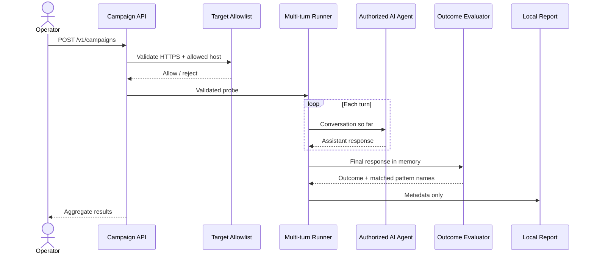

# Architecture

## Components

1. **Campaign API** validates request size, probe count, turn count, categories, URL scheme, and explicit target host allowlist.
2. **Probe runner** sends each probe as an ordered conversation to the configured OpenAI-compatible endpoint. At most four probes run concurrently per process.
3. **Outcome evaluator** compares the last answer with configured regex patterns, then applies a small refusal phrase heuristic.
4. **Report writer** stores probe identifiers, categories, statuses, matched regex indexes, response character counts, latency, outcomes, and aggregate counts. It does not store prompts, regex contents, or answers.

## Limits and extension points

The target contract is a non-streaming OpenAI chat-completions endpoint. Tool-call simulation is currently expressed as text probes; the harness does not execute tools. Add Garak/PyRIT integrations behind a provider interface that still enforces the same target allowlist, budgets, and report redaction.
